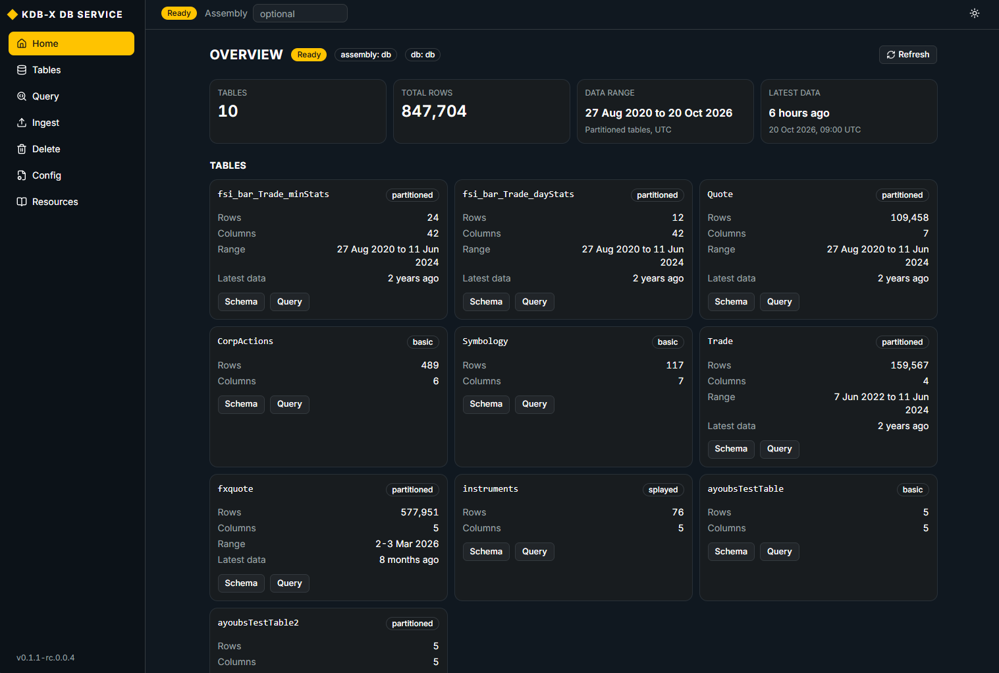
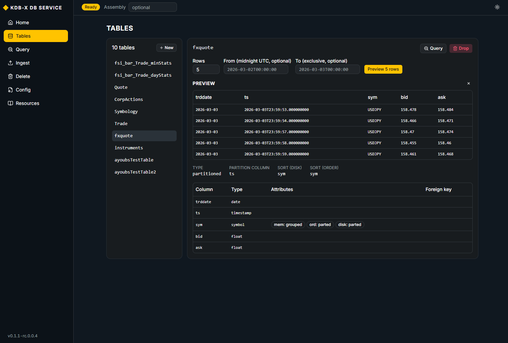
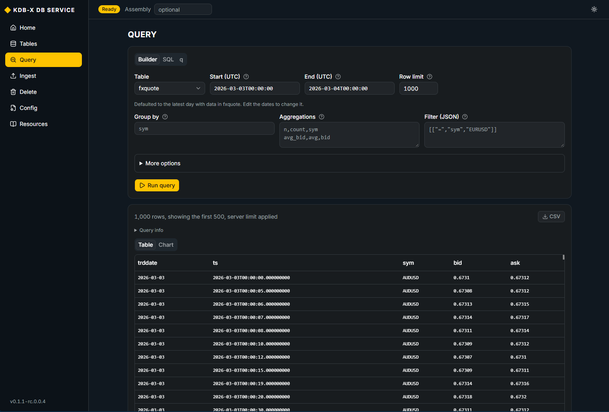
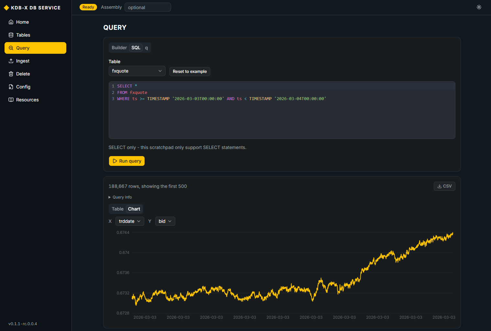

# KDB-X DB Service GUI

This is a fork of [KxSystems/kdbx-db-service](https://github.com/KxSystems/kdbx-db-service). Its purpose is to provide a  lightweight browser UI on top of the DB Service REST API, shipped as an optional add-on to the standard Docker deployment.

Everything else in this repo is unchanged from upstream. For setup, usage, and the current documentation, see the upstream README:

**[KxSystems/kdbx-db-service README](https://github.com/KxSystems/kdbx-db-service/blob/main/README.md)**

# Quickstart

From your DB Service directory, download the built package:

```bash
curl -fsSLO https://raw.githubusercontent.com/ajdair/kdbx-db-service/main/ui/docker-compose.ui.yaml
```

Start the package alongside your stack:
```bash
docker compose -f docker-compose.yaml -f docker-compose.ui.yaml up -d
```

Open `http://127.0.0.1:3000/`

To remove it, run `docker rm -f kx-db-ui`.

> **Note**: 
> Run this in the folder where you started the DB Service. Compose reads only the files you name with `-f`, so if you started your stack with extra compose files (for example `docker-compose.fsi.yaml`), list them too, before the UI file:
> ```bash
> docker compose -f docker-compose.yaml -f docker-compose.fsi.yaml -f docker-compose.ui.yaml up -d
> ```
> If you leave one out, compose recreates the containers that file changes without its settings. To avoid retyping the list, set it once in the `.env` file next to the compose files:
> ```bash
> COMPOSE_FILE=docker-compose.yaml:docker-compose.fsi.yaml:docker-compose.ui.yaml
> ```
> After that, a plain `docker compose up -d` includes the UI.

> **Note**:
> The package uses the newest release. Compose reuses an image it already has. To update to the `latest` package, pull it and start it again:
> ```bash
> docker compose -f docker-compose.yaml -f docker-compose.ui.yaml pull kx-db-ui
> ```
> ```bash
> docker compose -f docker-compose.yaml -f docker-compose.ui.yaml up -d
> ```


## About the GUI

The UI lives in [`ui/`](ui/). It is a small single-page app & talks only to the REST API on port 8080.

Features:

- **Overview**: Status and overview of your service
- **Tables**: Browse tables and schemas, preview rows, create & drop tables
- **Query**: Run queries (structured builder, SQL, and q) with CSV export and a chart
- **Ingest**: Start and monitor your data imports
- **Delete**: Delete all or specific rows from your tables
- **Config**: View your assembly config and download a copy
- **Resources**: Helpful links & resources for DB Service

**Overview:**



**Tables:**



**Query:**



**Graph:**


